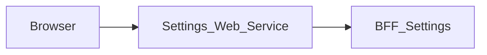

# Settings_Web_Service — Technical documentation

## Cookie gate and real401 handoff — MAIR-405

Middleware restores the reference's presence/decoded-expiry check before nonce
CSP on authenticated requests. It is not signature verification: opaque tokens
are forwarded for the unchanged BFF's real verification. Data under `/settings/`
and the explicitly matched `/openapi.json`/`/swagger.json` receive no-store JSON401
without an upstream call when the cookie is missing/expired. Other documents go
to validated runtime `LOGIN_FRONT_URL` (307 for GET/HEAD,303 otherwise); absent or
unsafe configuration fails closed with503. Cookie deletion honours optional
`COOKIE_DOMAIN` and does not claim server revocation. Static asset exclusions are
unchanged except the two explicit metadata entries.

The client checks AbortSignal before sending and after receiving, then hands
real401 to the existing Login `/logout` navigation once per Location. It never
replays a PATCH, accepts a401 as success, reads browser tokens or navigates on
400/403/503/network failures. Invalid Login yields a controlled message. Public
URL validation is shared with existing navigation. The contract/proxy, CSP
directives, dependencies, CI gates, permissions and deployments are unchanged.
The audit's admin-role, timezone and real-session findings remain separate.

## Shared footer — MAIR-180

The unchanged CI audit exposed the transitive tooling dependency
`brace-expansion@1.1.18`. Its lock entry now resolves to the compatible patched
`1.1.21`, with registry-verified integrity, as documented in
[the upstream advisory](https://github.com/advisories/GHSA-qhr7-859c-m2p7).
No audit threshold, workflow or security policy is relaxed.

The package is pinned to published `@mairie360/lib-components@0.6.8` from
[the successful 0.6.8 publication](https://github.com/mairie360/lib-components/actions/runs/36836970818), including the sidebar-footer correction #388.
AppShell now places copyright in the dark sidebar, outside scrolling navigation.
The mobile drawer retains focus management. No content-footer band reduces the
main viewport; only supplied information is shown, with no invented version.
Contracts, APIs/BFFs and deployment approvals are unchanged. Consumer adoption
is tracked in [shared issue #387](https://github.com/mairie360/lib-components/issues/387).

[Module overview](module.md) · [Français](../fr/technical.md) · [README](../../README.md)

## Architecture and request handling

Next.js 15.5.25, React 19 and TypeScript application using the App Router. The browser calls same-origin routes; the Next.js server forwards data to **BFF_Settings**.



The page keeps the editable profile and bootstrap data in React state. `save` submits `/settings/profile`, then replaces the form with the saved response. `src/lib/profile-form.ts` holds the form rules mirrored from the `SettingsProfilePatch` schema (`maxLength`, HTML `pattern`, help text, pinned to `contracts/openapi.json` by a test), the e-mail comparison of the BFF, the conditional `current_password` and the French wording of a refused save (`saveErrorMessage`: `error.details[]` labelled per field, 403, 409). `requestBff` throws a `BffRequestError` carrying `status`, `error.code` and `error.details[]` next to the unchanged `message`. Other tabs display their available or unavailable state without simulating a save.

The generic proxy reads the versioned OpenAPI contract to allow paths and methods. It preserves query parameters, binary bodies, statuses and useful headers, filters transport headers, disables caching and does not automatically follow redirects. Its timeout is 15 seconds.

## Data and persistence

The following sources and limitations describe the associated BFF, which determines persistence for the displayed data.

The profile comes from Core `/api/v1/user/me/`; sessions come from `/api/v1/sessions/`. Fields are `first_name`, `last_name`, `email` and `phone` (`phone_country` is read but not edited; an e-mail change also sends `current_password`). The session schema retains displayable information and removes internal fields. The BFF stores no preferences locally.

Notifications, appearance and general remain unavailable. System hosts local assistance only. Security displays sessions without managing other settings. The preference paths currently have empty request/response schemas and bootstrap provides no preference values; route existence alone does not establish a usable contract.

### Local assistance (MAIR-304)

`src/components/settings-assistance.tsx` handles user-triggered exports without an effect, timer loop, network call or persistence. `src/lib/local-assistance.ts` validates authored text (nonblank, at most 5,000 characters), builds plain-text/JSON files and requests a Blob download. An appended temporary anchor is removed immediately; its object URL is revoked after one second on success or immediately on failure. The UI reports a download request, not a confirmed saved file or delivered support message. Raw exceptions never reach the assistance UI or exported diagnostic.

Only coarse browser/OS labels are derived from `navigator.userAgent` when the diagnostic button is clicked. MAIR-471 also displays those local families through `settings-browser-information.tsx`: `useSyncExternalStore` uses stable string snapshots, a no-event subscription and a deterministic server placeholder, so no browser access occurs during SSR or hydration's initial render. Unknown families remain unidentified; an inaccessible getter displays unavailability without raw exceptions. No raw user-agent or browser version is rendered, retained in application storage or exported. The diagnostic JSON allowlist remains `module`, `generatedAt`, `browser`, `operatingSystem`, `capabilities.objectUrls`. No business DTO is passed to the component, no storage is read/cleared and no deployment version/date or quota is invented. No new environment, package, route, permission or BFF operation is required.

Node tests cover export validation/content/privacy and download cleanup; component tests exercise the real page, keyboard access, axe checks, errors/retry and the absence of additional bootstrap calls. The contract harness also verifies the System tab adds no upstream operation.

React state manages display and pending operations. This repository defines no business database of its own; save guarantees come from the BFF and its sources described above.

## Installation and local startup

Use Node.js 24 and npm >=11.10 with the committed lockfile to reproduce the CI toolchain and its seven-day npm release-age policy. The internal UI package is the only existing age exception. Other job and Docker versions are detailed below.

Private `@mairie360/*` dependencies require GitHub Packages access. Set `NODE_AUTH_TOKEN` in the environment to a token allowed to read these packages, as configured in `.npmrc`. Do not commit its value.

```bash
npm ci
```

Create `.env.local` in the repository root. Example for the BFF running on the same machine:

```dotenv
SETTINGS_BFF_URL=http://localhost:4008
```

Start BFF_Settings, the only BFF this front calls, then start the web service. Port `5008` below is an explicit local choice to avoid collisions; it is not a claim about ports in every Compose file.

```bash
npm run dev -- --port 5008
```

Open `http://localhost:5008`. To run the build with the Next.js script:

```bash
npm run build
npm run start -- --port 5008
```

## Configuration

Values below are local examples or explicitly described behavior, not production credentials.

| Variable or precedence | Explicit local example | Purpose |
| --- | --- | --- |
| `SETTINGS_BFF_URL` → `BFF_SETTINGS_BASE_URL` | http://localhost:4008 | Left-to-right proxy precedence; configure an HTTP(S) URL explicitly. Missing or invalid configuration returns an uncached 503 without contacting an upstream. |
| `LOGIN_FRONT_URL` | — | Validated runtime Login origin used to open `/logout`. |
| `KEYCLOAK_REALM_URL` | https://auth.mairie360.fr/realms/mairie360 | Public realm URL (MAIR-357), read on the server by `src/lib/keycloak-account.ts`. The Security tab links to `<realm>/account` to manage the second factor; absent or invalid hides the link: HTTPS only (HTTP for a loopback host in local development), path `…/realms/<realm>`, no credentials, query or fragment. |

The shared navigation reads `DASHBOARD_FRONT_URL`, `PROJECT_FRONT_URL`,
`MESSAGE_FRONT_URL`, `ELEARNING_FRONT_URL`, `CALENDAR_FRONT_URL` and
`ADMINISTRATION_FRONT_URL` from the server's runtime environment and passes
them to the browser. Only configured HTTP(S) destinations without embedded
credentials are shown; an absent or invalid URL hides that link. Settings and
profile always use this front's `/` route. These are navigation destinations,
not additional BFF connections. The current Settings bootstrap publishes no
role or notification inbox, so the shell does not claim administrator access
or show a notification badge.

Inside a container, `localhost` refers to that container. Use the BFF service DNS name on the Docker network or a reachable host address. Compose files sometimes include other services and legacy settings; check effective URLs and ports before using them.

## Routes and data contract

Inventory extracted from `contracts/openapi.json`. Replace brace parameters with real identifiers. Detailed types, required fields, responses and any examples are defined in that contract; table statuses are the declared statuses, not an exhaustive list of transport or validation errors.

These data paths are exposed at the same origin through the proxy; Next.js pages are separate. `/openapi.json` and `/swagger.json` are also forwarded. Open the `/docs` Swagger UI directly on the BFF.

| Method | Path | Declared body | Declared statuses |
| --- | --- | --- | --- |
| GET | `/health` | — | 200 |
| GET | `/check_apis` | — | 200, 502 |
| GET | `/settings/bootstrap` | — | 200, 401, 502 |
| PATCH | `/settings/profile` | application/json | 200, 400 (`details[]`), 403 (wrong `current_password`), 409 (e-mail in use) |
| PATCH | `/settings/notifications` | application/json | 200, 404 |
| PATCH | `/settings/appearance` | application/json | 200, 404 |
| PATCH | `/settings/general` | application/json | 200, 404 |

### Pages

| Page | Source |
| --- | --- |
| `/` | [src/app/page.tsx](../../src/app/page.tsx) |

The only route handler is the contract-gated BFF proxy ([src/app/[...path]/route.ts](../../src/app/%5B...path%5D/route.ts)). Logout is a browser navigation to Login's `/logout` page, not a Settings route; session paths such as `/api/user/me` remain unavailable.

## Session, permissions and errors

The session comes only from the `accessToken` cookie set by Login_Web_Service. The generic proxy uses an explicit Bearer header or, when absent, the `accessToken` cookie. Business permissions remain those of the BFF and its sources.

The AppShell account menu validates the runtime `LOGIN_FRONT_URL` and navigates to its `/logout` page. If the URL is missing or invalid, Settings stays in place and reports an error. Login owns shared-cookie expiry and its BFF User logout call; Settings makes no logout request and never contacts a second BFF. End-to-end authenticated logout and Keycloak-wide revocation remain to be verified under MAIR-143/MAIR-226.

The generic proxy returns 400 for an invalid path, 404 for a path outside the contract, 405 for a disallowed method and 502 when the service is unreachable or times out. Upstream responses are preserved, including empty 204/205/304 bodies.

Every response carries `X-Frame-Options: DENY`, `X-Content-Type-Options: nosniff`, `Referrer-Policy`, `Permissions-Policy` and `Cross-Origin-Resource-Policy`, `Cross-Origin-Embedder-Policy` and `Cross-Origin-Opener-Policy` (`next.config.ts`), and `X-Powered-By` is disabled. [src/middleware.ts](../../src/middleware.ts) adds a `Content-Security-Policy` with a per-request nonce to each page that passes the session gate, which Next.js applies to its scripts. Pages are therefore rendered on demand (`dynamic = "force-dynamic"` in the layout). Stylesheets are limited to the origin and the nonce; only `style` attributes rendered by shared components are allowed through `style-src-attr 'unsafe-inline'`, and `next dev` also allows `'unsafe-eval'`. Any new external resource (image, font, API called from the browser) must be added to the policy in `src/lib/content-security-policy.ts`.

## Synchronization and verification

The front uses a single contract: the one **BFF_Settings publishes** in the `@mairie360/bff-settings-openapi` package, pinned to an exact version in `package.json`: a release `X.Y.Z`, or, while no release is cut, the `0.0.0-dev.<sha>` package the CICD publishes for the current commit of its `main` (MAIR-509; never a `staging` pre-release). It is never copied from a BFF checkout, which can be ahead of what is published. After a new BFF_Settings release or dev package, run in this repository:

```bash
npm install --save-exact @mairie360/bff-settings-openapi@<version>
npm run contracts:sync
npm run contracts:check
npm run test:contracts
npm run lint
npm run build
```

The package only contains orval output (TypeScript models and endpoints). `contracts:sync` (alias `contracts:generate`) rebuilds `contracts/openapi.json` from the installed package with `scripts/orval-contract.mjs`; the proxy reads that file and the code imports its types from `@mairie360/bff-settings-openapi/model`. `contracts:check` fails if the version is not an accepted exact version (`scripts/contract-version.mjs`), if the installed package differs from `package.json`, if a second `bff-*-openapi` package exists or if `contracts/openapi.json` is stale. These commands run offline. After a bump, also move the `bff-settings` image tag of the stacks to the image built from the same commit (`X.Y.Z` for a release, `dev-<sha7>` for a dev package). BFF errors use the shared `ErrorResponse` envelope (`{ error: { code, message, details } }`). `test:contracts` runs the Node tests without coverage; `npm test` runs them with a 60% threshold (lines, branches, functions) over every `src/**/*.ts` module.

The tests check that the front only reaches the network through its published BFF contract. `tests/network-contract.test.cjs` scans the TypeScript AST of `src/`: only `src/lib/bff-client.ts` and `src/lib/bff-proxy.ts` call `fetch`, every business request is a generated `bffSettings.<operation>` call (all in `src/lib/settings-api.ts`, no path string) naming an operation of the generated client and of `contracts/openapi.json`, carried by `requestBff` through an axios adapter, and the only server relay is the proxy to `configuredBffUrl()` (the only BFF URL read from the environment is `SETTINGS_BFF_URL` → `BFF_SETTINGS_BASE_URL`). `tests/settings.bff-mocks.test.cjs` runs the BFF chain against a contract-driven mock. `tests/logout.test.cjs` checks the validated Login handoff and safe failures without any second BFF. `tests/package-contract.test.cjs` checks the exact package pin and contract rebuild.

For documentation-only changes, check links, accuracy in both languages and `git diff --check`; do not regenerate contracts without bumping the package.

## CI/CD and Docker execution

The `contracts.yml` job uses Node.js 24.21.0 and immutable commit references for `actions/checkout` and `actions/setup-node`. It runs on pull requests, manual dispatch and pushes to `main` only (MAIR-436); it installs with `npm ci`, checks contracts and runs the associated tests.

`cicd.yml` calls `mairie360/CICD/.github/workflows/frontend-cicd.yml` pinned to a CICD commit, with the same `cicd_version` and `node_version: "24.21.0"`. It runs on pull requests, on manual dispatch and on pushes to `main` only; its token is read-only by default and only the job calling the release pipeline gets `contents`, `packages` and `id-token` write scopes (MAIR-436, `tests/workflow-permissions.test.cjs`). This existing shared workflow blocks build/tests on npm audit and Semgrep/Gitleaks. Its Dev publication is automatic on main; Staging/Prod retain distinct environment gates. No deployment pins or approvals are changed here.

MAIR-230 / issue #79 adds a consumer-only `required_security_scan` job named
`CICD / Code Security Audit (Semgrep)` because protection still requires that
legacy name after the shared v4 rename. This job really reruns BOTH scanners,
not a success alias: it checks out frontend history and the published v4.0.1
actions at immutable commit `539847726d4058a9565c4f682c2d1d8302874b06`, uses the
same six frontend rulesets and explicitly blocks on findings/crashes. Published
pinned scanner images and redacted Gitleaks remain unchanged. The two Semgrep
runs have distinct SARIF artifact names. The job has `contents: read` only,
no secret mapping or persisted checkout credentials, no exclusion override,
and no access/ruleset/security bypass. The existing shared audit and all other
gates continue to run. Regression tests check this compatibility wiring; CI
must prove the actual scan succeeds before normal merge.

The Dockerfile pins `NODE_VERSION=24.21.0` (official bookworm-slim image pinned by digest) and the Next.js `standalone` build; the image command is `["node", "server.js"]`. Image ports and Compose mappings can differ from the local port suggested above.

Before running Docker, check service variables, build secrets and networks in the repository files. Green CI validates its jobs; it does not prove business-service availability in a remote environment.

### End-to-end journeys (MAIR-603)

`./e2e_test.sh` starts `docker-compose-e2e.yml` (the performance stack with a Playwright runner in
place of k6) and runs the journeys of `e2e/`: a profile change saved and still there after a reload, refusal of an e-mail change with a wrong current password, and a forged session refused. The prod promotion runs the same script on
the verified `staging-<sha>` image (`e2e_tests` job, mairie360/CICD `actions/e2e/fronts`,
MAIR-602) and blocks the release when a journey fails or when the folder is missing. The report
(HTML, traces and videos of the failed journeys) is kept in `e2e-report/`. For local iterations,
start the stack with `docker compose -f docker-compose-e2e.yml up -d settings-front` and run
`E2E_BASE_URL=http://localhost:5000 npm run e2e` (after `npm run e2e:install`); tear it down with
`down -v` before a new run.

## Troubleshooting

Associated BFF diagnostics: If the profile loads but sessions do not, check `sources.sessions` and the Core `/api/v1/sessions/` response. PATCH 400 can result from an unknown field or an empty body. An unavailable panel should not be interpreted as a failed save.

For a proxy error, compare the path and method with the inventory, then check the BFF URL and session. For a 401 after navigating between modules, check the `accessToken` cookie and its domain. A 404 for a requirement described in `BACKEND.md` may refer to a feature that is only proposed.

## Repository reference

- [src/app/page.tsx](../../src/app/page.tsx)
- [src/lib/bff-client.ts](../../src/lib/bff-client.ts)
- [src/lib/bff-proxy.ts](../../src/lib/bff-proxy.ts)
- [src/app/[...path]/route.ts](../../src/app/%5B...path%5D/route.ts)
- [src/lib/settings-api.ts](../../src/lib/settings-api.ts)
- [contracts/openapi.json](../../contracts/openapi.json)
- [scripts/orval-contract.mjs](../../scripts/orval-contract.mjs)
- [scripts/contracts.mjs](../../scripts/contracts.mjs)
- [package.json](../../package.json)
- [.github/workflows/contracts.yml](../../.github/workflows/contracts.yml)
- [.github/workflows/cicd.yml](../../.github/workflows/cicd.yml)
- [Dockerfile](../../Dockerfile)
- [docker-compose.yml](../../docker-compose.yml)

Historical supplements: [BFF.md](../../BFF.md), [BACKEND.md](../../BACKEND.md). Proposed requirements must remain distinct from implemented behavior.

Presentation checks mount the actual Settings page, its real React hooks and published UI 0.6.12 with the existing canonical bootstrap fixture at the API-function boundary. Computed styles cover typography, shell/sidebar/drawer, tab selection, the four profile fields and opening/closing bounded assistance content. Parsed policies preserve breakpoint associations, the Tailwind font token, focus outline and backdrop configuration. JSDOM does not compile Tailwind, evaluate media queries, measure native geometry or establish deployed BFF response schemas, persistence or RGAA compliance. Native responsive/dialog/keyboard recipes and HTTP contract tests remain separate; no product, contract or RGAA configuration changes.
